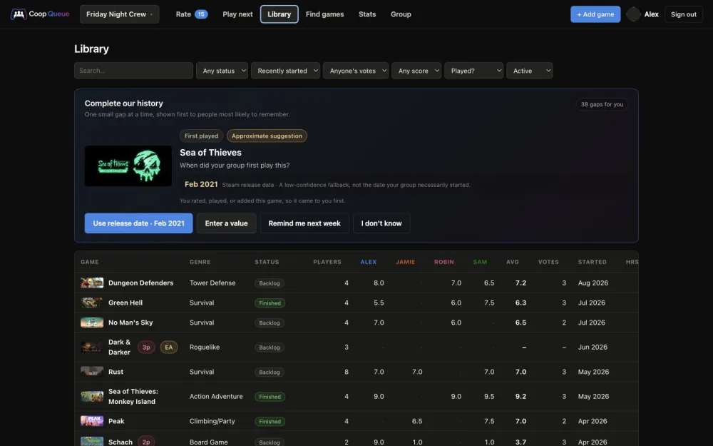
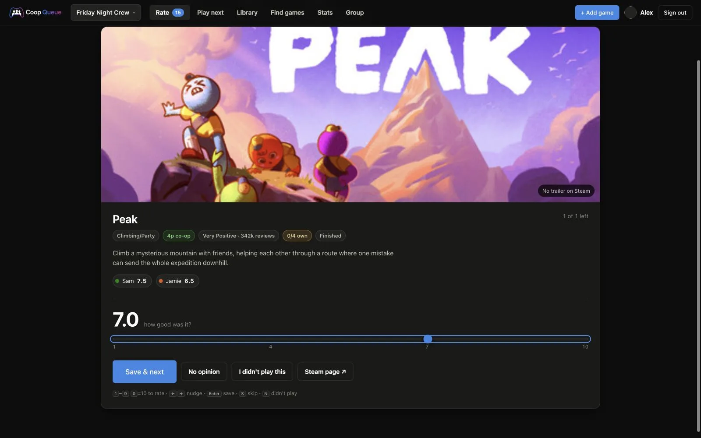
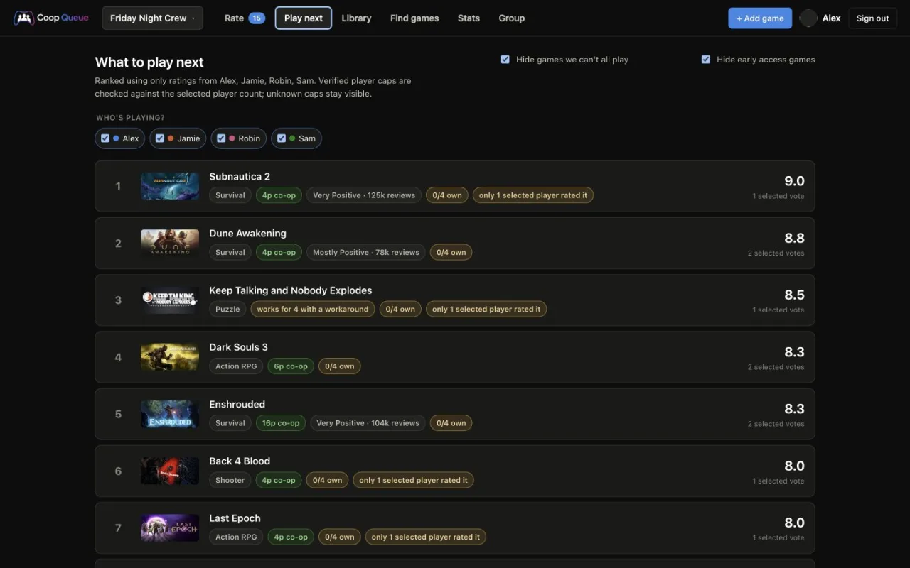
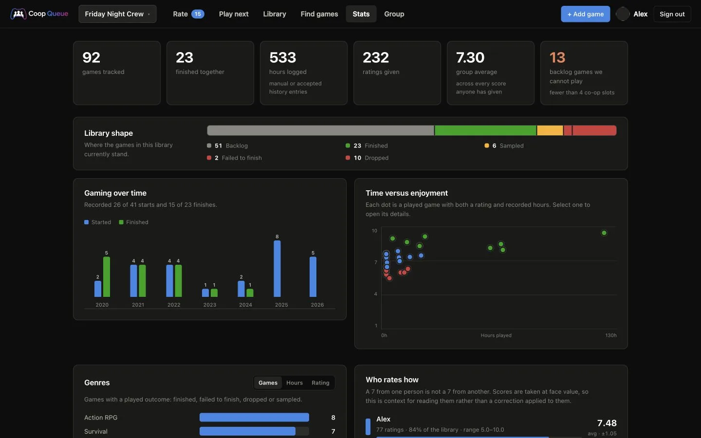

<p align="center">
  
</p>

# CoopQueue

A co-op game tracker for groups of friends, with a personal-library mode that
reuses the same backlog and history tools without diluting the co-op defaults. Sign in with Steam, create a group,
rate games in a queue with the trailer playing, suggest new ones by pasting a
store link, and settle "what next" with a group score shown next to how many
people voted for it — and with a check on whether your whole group can even fit
in the lobby.

Multi-tenant: any number of co-op groups or personal workspaces, each with its
own library. One person can belong to several.

**Running cost: €0/month** on Cloudflare's free tier, which is not a trial and
does not sleep. Rough headroom is in [Scaling](#scaling-and-what-it-would-cost).

---

## See it in action



<table>
  <tr>
    <td width="33%">
      <br>
      <strong>Fast, focused voting.</strong> One game at a time, with keyboard-friendly controls.
    </td>
    <td width="33%">
      <br>
      <strong>A shortlist that fits.</strong> Choose tonight's crew and the backlog re-ranks immediately.
    </td>
    <td width="33%">
      <br>
      <strong>Statistics backed by real data.</strong> Empty charts simply stay out of the way.
    </td>
  </tr>
</table>

The screenshots use the realistic `g4m1ng` fixture with publishable placeholder
identities; no member account, avatar, invite code or private comment is shown.

---

## What it does

**Rate.** A queue of everything you personally haven't scored yet, one card at a
time, with the Steam trailer embedded. It is split into two modes, because it asks
two different questions: **Played** ("how good was it?") and **Want to play**
("how much do you want to play this?"). Played comes first — it is the smaller set
and the more perishable, since memory fades. Keyboard-driven: `1`–`9` (`0` = 10),
`←` `→` to nudge by half a point, `Enter` to save and advance, `S` to skip.
Forty unrated games takes about three minutes.

**Play next.** The backlog ranked, with attendee chips directly above it. Changing
who is playing immediately recomputes the score from only those people's ratings
and checks verified player caps against that crew. Unknown caps stay visibly
unknown instead of emptying the list; verified games that are too small move to a
separate block. Steam header art keeps both lists recognizable at a glance.

**Library.** Every game, every score, sortable — including by "most
disagreement" and "fewest votes", which is how you find what needs attention.
Filterable by whose votes a game already has, by group score, and by whether
anyone has logged hours. A one-question-at-a-time **Complete our history** card
finds missing first-played, last-played and group-hours facts for games the group
has actually played. It asks likely participants first, offers clearly marked
Steam/release-date approximations when there is honest evidence, and lets each
person answer, defer or dismiss a prompt without hiding it from everyone else.
Personal libraries collapse the group-only player, member, average and vote-count
columns into one **Rating** column.

**Find games.** The most-reviewed online co-op games on Steam, as a global
catalogue, defaulting to a **Recommended for us** order built from your group's
own ratings — and it names the tags it based that on, so you can disagree with
it. A **Co-op only** filter is on by default. Search results and catalogue cards
link to the official Steam page in a new tab, so you can check the details before
adding anything. Add the ones your group might play to its **library**, and only
library games ever appear in anyone's rating queue.
That opt-in step is the whole point: a catalogue of thousands would otherwise
bury the handful of votes that decide what you actually play. Games whose player cap nobody has verified say so
rather than guessing, and the "only ones we can all play" filter leaves them out
instead of claiming they fit.

**Coverage.** Your own unrated count sits above the rating queue, and the Group
tab ranks everyone by how much of the library they have scored. Rating coverage
is the thing that decides whether any of the scoring means anything, so it is
not hidden in a stats page.

**Stats.** A compact full-width library-status summary followed by paired genre and
rating profiles, yearly starts and finishes, time-versus-rating, and a dot
plot of your biggest arguments. Missing hours remain unknown and every history
chart shows its date coverage. Panels with no underlying data stay hidden.
Personal workspaces add a completion track record, rating distribution, playtime
buckets, backlog check-in, personal records and an achievement cabinet while
omitting comparisons that require another person.

**Steam ownership and trophies.** A three-state ownership badge uses the public
libraries already synced from the Group tab: owned, absent from a sufficiently
recent sync, or unknown. Private and stale data are never relabelled "not owned".
Each game's detail panel also has a **Trophy relay**: opening it automatically
refreshes the signed-in member's stale or missing progress for that one game, then
the group sees its combined progress, fresh unlocks and achievements that are one
person short of a clean sweep. Personal workspaces turn it into a **Trophy trail**
with playful progress ranks. A refresh button remains for retries.

**Personal workspaces.** Create one directly during onboarding, or convert an
existing one-person group from Settings without losing games, ratings or history.
They have no invite link or group-only comparisons, use your Steam playtime in
history and Stats, and retain the co-op-first catalogue and verified-cap metadata.
Settings includes a selective Steam import for both the owned library and public
wishlist. It previews every candidate before writing, with source filters,
select/deselect-all controls, import actions above and below the list, and owned-only
or wishlist-only shortcuts. A new
personal workspace opens this review immediately; cancelling an empty import goes
to Find games instead of an empty rating queue. New co-op groups also begin in Find
games. Source filters load their complete candidate set, and larger reviewed
selections are submitted in bounded batches. Played
games begin as **Sampled**; unplayed and wishlisted games begin as **Backlog**.
Exact lifetime minutes are rounded to one decimal hour. Verified catalogue player
caps carry across; unknown caps remain visibly unknown. Store art is filled in
through the shared metadata cache in small resumable batches. Playtime sync is part
of the import; metadata and achievement analysis begin automatically in bounded
passes and remain resumable from Settings. Achievement analysis can save the
earliest unlock as an approximate first-played boundary. It shows **Likely finished**
only for a small curated set of explicit ending achievements, and the player must
confirm every status change.

Opening a workspace normally leads to Rate while it has unrated games. Once the
queue is clear it opens the Library instead, or Find games when the library itself
is empty. Workspace names only need to be unique within one person's own switcher;
unrelated private workspaces may use the same name.

**Group / Settings.** Members, invite links you can rotate or disable, the headcount that
drives the viability check, and owner-only JSON or per-table CSV exports — including
history provenance — before a group is permanently deleted.

### The scoring model

The group's score is the **plain average**, shown next to the number of votes.

That is a deliberate choice rather than a shortcut. An earlier version calibrated
each rating against that person's own history and shrank thin results toward the
group mean. It was removed: a rating is a judgement, not a measurement needing
correction — somebody who has only ever given 8s and 9s may simply have played
good games, and may well give the next one a 4. And a score you cannot reconstruct
from the column beside it is a poor way to settle an argument.

Thin evidence is shown rather than corrected for: a 9.0 with one vote sits next to
a **1** in the Votes column, and the Library sorts by it.

### The viability check

Every game carries `max_players` — the maximum *simultaneous online co-op*
count, which is frequently not what a store page advertises. Compared against
the group's own headcount, a game is viable, blocked, or a workaround (couch
co-op that works over Remote Play Together, or one-copy games like Keep Talking
and Nobody Explodes). Steam's own co-op tags are stored as a hint but never
treated as the truth, because they routinely are not.

---

## Accounts and login

**There is no registration.** No email, no password, no confirmation link —
nothing to store and nothing to reset. Everyone signs in with **Steam OpenID**,
which is free, needs no approval from Valve, and is the same "Sign in through
Steam" flow people already know from Humble Bundle and SteamDB.

What actually happens on first sign-in:

1. The person clicks *Sign in through Steam* and lands on Valve's own login
   page. They type their Steam password **on steamcommunity.com**, never here —
   this site never sees a credential of any kind.
2. Steam redirects back with a claim, which the server hands straight back to
   Steam (`mode=check_authentication`). Nothing in that redirect is trusted
   until Valve confirms it. This matters: without the callback check, OpenID is
   trivially forgeable by editing the URL.
3. On success we store one row — their SteamID64, display name and avatar — and
   set a signed session cookie good for 90 days.

That account is just an identity. It grants access to nothing until they either
**create a co-op group or personal workspace** or **join one with an invite link**. Groups are private by
default: a non-member asking for `/api/g/some-group/games` gets a 404, not a
403, so a private group can't even be confirmed to exist by guessing the URL.

So for your four: you sign in, claim the "Ama" identity, create an invite link
on the Group tab, and send it to the other three. They click it, sign in with
Steam, and land straight in the group with the claim prompt waiting.

Using Steam rather than email has one more payoff. Because a SteamID64 is a real
Steam account, playtime and ownership come from Steam's public Web API keyed on the
ID already stored. Achievement completion uses that API first and Steam's public
Community profile as a fallback when its stats method refuses an otherwise valid
key. The Community view can expose a game's achievement list while hiding every
personal unlock, so an all-zero fallback remains unknown rather than becoming a
false 0%. Both paths respect Steam privacy: hidden or stale data is never guessed.

If you want the instance private while you try it out, set `ALLOWED_STEAM_IDS`
and only those Steam accounts can sign in at all. Leave it unset to let anyone
create their own groups.

---

## Setup

One command does the whole thing:

```bash
npm install
npm run setup
```

It will open a browser once for the Cloudflare login, then create the Pages
project and the D1 database, write the database id into `wrangler.toml`, apply
the schema, offer to import the 92-game seed data, generate and store
`SESSION_SECRET`, prompt for an optional Steam API key, and deploy. It prints
your live URL at the end.

The script is safe to re-run — every step checks for existing state first, so if
something fails you can fix it and run it again without duplicating anything.
It never applies the destructive fresh-install schema when tables already exist.

You need a free Cloudflare account (no card) and, optionally, a free Steam Web
API key from <https://steamcommunity.com/dev/apikey>. The key is used for display
names and avatars, manual library/playtime sync and per-game achievement sync.
Without it the tracker and ratings still work, but those Steam-backed features do not.

### Deploying from GitHub instead

For a real product you probably want pushes to deploy themselves. After running
`npm run setup` once, go to Workers & Pages → **coopqueue** → Settings → Builds,
connect the GitHub repo, set the build command to nothing and the output
directory to `public`. Every push to `main` then deploys, and pull requests get
preview URLs. The D1 binding comes from the committed `wrangler.toml`; secrets
stay in the dashboard.

### Doing it by hand

<details>
<summary>If you would rather run the steps yourself</summary>

```bash
npx wrangler login
npx wrangler pages project create coopqueue --production-branch main
npx wrangler d1 create g4m1ng            # paste the id into wrangler.toml
# Only against the brand-new, empty database created on the line above:
npx wrangler d1 execute g4m1ng --remote --file=./schema.sql
npx wrangler d1 execute g4m1ng --remote --file=./seed.sql      # optional
openssl rand -base64 32 | npx wrangler pages secret put SESSION_SECRET --project-name coopqueue
npx wrangler pages secret put STEAM_API_KEY --project-name coopqueue
npm run deploy
```

</details>

### After the first deploy

Imported games have names but no Steam links, so the queue has no trailers for
them yet. Sign in, open your group, and:

```bash
curl -X POST https://coopqueue.pages.dev/api/g/g4m1ng/enrich \
     -H "Cookie: g4_session=..."   # copy from browser devtools
```

Eight games per call — Steam throttles at roughly 200 requests per 5 minutes —
and only unambiguous name matches link automatically. Repeat until `remaining`
is 0. Anything in `needsReview` you link by hand: open the game in the Library
and paste its store URL. Being conservative here is deliberate; a wrong appid
means the wrong trailer plays in the queue.

For a custom domain, add it under Workers & Pages → coopqueue → Custom domains.
Cloudflare charges nothing for the hosting; you just pay a registrar for the
domain (~€10/year).

---

## Local development

```bash
cp .dev.vars.example .dev.vars     # then edit SESSION_SECRET
npm run db:init:local
npm run dev
```

Steam OpenID won't redirect back to `localhost`, so for UI work use the test
harness instead — it serves the real frontend against an in-memory copy of the
schema with auth stubbed:

```bash
node test/harness.mjs                 # signed in, co-op and personal fixtures
SCENARIO=anon  node test/harness.mjs  # landing page
SCENARIO=fresh node test/harness.mjs  # signed in, no groups
SCENARIO=claim node test/harness.mjs  # first run in a group
```

### Tests

```bash
node test/isolation.mjs   # 161 tenancy / permission / scoring assertions
node test/shots.mjs       # renders every screen, fails on any console error
```

`isolation.mjs` imports the **real route handlers** and runs them against a D1
shim over SQLite, so it tests shipped code rather than a reimplementation. It
covers the things that would actually hurt: cross-group reads, cross-group
writes by guessed id, invite-code validation, owner-only actions, and the
last-owner-can't-leave rule.

---

## Layout

```
functions/
  _middleware.js                 who are you — session cookie → users row
  api/
    auth/steam.js                start Steam OpenID (carries an invite code)
    auth/callback.js             verify with Steam, set the signed cookie
    me.js                        current user + their groups
    groups/index.js              GET my groups · POST create one
    groups/join.js               POST an invite code
    steam/search.js              store search for the add-a-game box
    g/[slug]/
      _middleware.js             THE TENANCY BOUNDARY — membership or 404
      games/index.js             GET the group library with scores · POST add
      games/[id].js              PATCH · DELETE · PUT to link a Steam appid
      history.js                 shared-history cleanup prompts
      play-night.js              attendee-specific backlog ranking
      export.js                  owner-only JSON and CSV downloads
      achievements.js            cached per-game Trophy relay
      rate.js  skip.js  stats.js  claim.js  members.js  enrich.js
lib/
  auth.js      HMAC-signed cookie sessions, optional signup allowlist
  groups.js    slugs, invite codes, membership lookup
  history.js   missing-fact prompts and bounded automatic suggestions
  stats.js     shared library-shape, genre, timeline and playtime aggregations
  score.js     plain-mean scoring + viability
  ownership.js three-state Steam-library ownership
  steam.js     Steam Web API and store endpoints, cache-first
  http.js      JSON responses, body parsing, score clamping
public/        index.html · app.js · styles.css — no build step
scripts/setup.mjs                one-command Cloudflare provisioning
schema.sql · seed.sql · recommendations.sql
test/          harness.mjs · isolation.mjs · shots.mjs
```

No framework, no bundler. Edit a file, `npm run deploy`, done.

### How tenancy works

Every group-scoped route lives under `functions/api/g/[slug]/`, and
`_middleware.js` there is the only place that decides whether you're allowed in.
It looks up your membership and, failing that, returns **404 rather than 403** —
so the existence of a private group can't be probed by guessing URLs.

Below that boundary, every single statement still filters on
`data.group.group_id`. Game ids are global and sequential, so
`PATCH /api/g/my-group/games/5000` must not touch group 2's game 5000 just
because you're a legitimate member of `my-group`. `test/isolation.mjs` asserts
exactly this for read, rate, patch, delete, and the rating queue.

### Security notes

Sessions are HMAC-SHA256-signed cookies (`HttpOnly`, `Secure`, `SameSite=Lax`,
90-day expiry) with no server-side session table. Steam OpenID responses are
verified by handing every parameter back to Steam with
`mode=check_authentication`; nothing in the callback URL is trusted before that
returns `is_valid:true`. Every database call uses bound parameters. All
user-supplied strings are escaped before reaching the DOM. Invite codes are
10 characters from a 32-symbol alphabet (~50 bits) and can be rotated or
disabled by the owner at any time.

Soft caps exist so one account can't exhaust the free tier: 20 owned groups per
person, 64 members per group, 2000 games per group. The root middleware also
limits Steam searches to 30/minute, Steam-backed writes to 20/5 minutes, and other
writes to 60/minute per signed-in account. JSON bodies are capped at 32 KB, Steam
calls time out after 10 seconds, and static responses carry a restrictive CSP and
the standard browser hardening headers.

---

## Scaling, and what it would cost

Free tier, per day: **100,000** Function requests, **5 million** D1 rows read,
**100,000** D1 rows written, **5 GB** storage. Static assets and bandwidth are
unmetered.

A rough sense of the shape: one person opening the app and rating twenty games
is on the order of a hundred requests and a few thousand row reads, because the
library loads in one call and everything after that filters client-side. A
hundred active groups is comfortably inside the free tier; a thousand is where
you'd start watching the dashboard. Storage is a non-issue — the whole original
spreadsheet is under 100 KB in D1.

If you outgrow it, **Workers Paid is $5/month** and includes 10 million requests
and 25 billion D1 row reads per month. That is the entire cost step; there is no
tier in between and no per-seat pricing. Realistically the site would need to be
genuinely popular before you'd notice.

**The actual constraint is Steam, not Cloudflare.** The store endpoints throttle
at roughly 200 requests / 5 minutes *per IP*, and Cloudflare Workers egress from
a shared egress pool. That's why `steam_apps` exists: metadata is cached globally by
appid with a 14-day TTL, so the thousandth group to add Terraria costs zero
Steam requests. Search can't be cached (unbounded query space) and is the thing
that would break first under load. If it does, the fix is a debounce on the
client plus a KV-backed cache of the last N search terms.

One thing to know before opening it up: D1's free tier has **no automatic
backups** (run `wrangler d1 export` on a cron — also free). The application now
rate-limits Steam search, Steam-backed writes, and ordinary writes per signed-in
account; the existing group, member, and game caps remain the longer-term guardrails.

---

## Further reading

- **[`docs/OPERATIONS.md`](docs/OPERATIONS.md)** — the runbook for a deployed
  instance: secrets, deploying, migrations, backups and recovery, catalogue
  maintenance, and a troubleshooting table of everything that has actually gone
  wrong.
- **[`AGENTS.md`](AGENTS.md)** — orientation for coding agents: the hard rules,
  the layout, and which constants are measured rather than chosen.
- **[`CLAUDE.md`](CLAUDE.md)** — the long form of all of the above, including the
  numbers behind every invariant.

## What's next

Steam playtime/ownership sync, attendee filtering, personal workspaces, group
exports, automatic per-game achievement progress, Complete our history, comments,
archiving and the recommender are
**done**. Still open,
roughly in value order:

- **Scheduled D1 backups** via a cron trigger running `d1 export`. The free tier
  has no automatic backups, and Time Travel only reaches back 30 days.
- **Verified player caps at scale.** Only 55 of 337 catalogue rows have one, so
  most cards read "player count unverified". `npm run measure:caps` measures Steam
  app matching and `multiplayer_modes.onlinecoopmax` coverage in IGDB without
  writing a single cap. It still needs confidential Twitch developer credentials
  and a real coverage run before any candidate is manually verified and migrated.
- **A weekly nudge** (Discord webhook) listing games with fewer votes than the
  group has members. Rating coverage is the app's core problem — in the original
  spreadsheet it ranged from 89% to 27% per person.
- **Public read-only group pages**, also the cheapest growth loop the site has.
